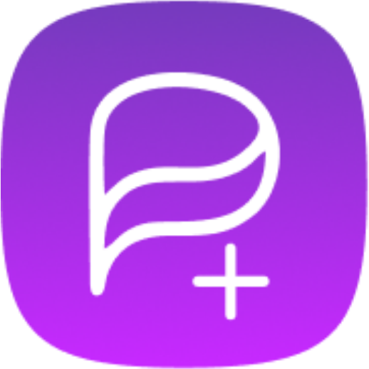

<div align="center">
  

  <h1>Planeja+ para ChatGPT, Codex, Hermes e Cursor</h1>

  <p>Plugin oficial do conector MCP do <a href="https://planejamais.planejareconsultoria.com.br">Planeja+</a>: planejamento estratégico, tarefas Kanban, reuniões, relatórios e tickets direto no seu assistente.</p>

  <p>
    <a href="https://github.com/hendrykcosta75/planejamais-codex-plugin/releases/latest"></a>
    <a href="LICENSE"></a>
    <a href="https://registry.modelcontextprotocol.io/v0/servers?search=io.github.hendrykcosta75/planejamais"></a>
    <a href="https://mcptry.com/servers/io.github.hendrykcosta75/planejamais"></a>
  </p>
  <p>
    
    <a href="https://claude.ai/directory/connectors/planejamais"></a>
    
    
  </p>
</div>

O plugin está publicado no catálogo da OpenAI (ChatGPT e Codex). Este repositório é só o pacote de
distribuição; o produto Planeja+ é mantido em outro repositório.

| Cliente | Como instalar |
|---|---|
| ChatGPT e Codex | Plugins → procure **Planeja+** → Conectar |
| Codex CLI | `codex plugin marketplace add hendrykcosta75/planejamais-codex-plugin` |
| Hermes Agent | `hermes plugins install planejamais` ([detalhes](#hermes-agent)) |
| Cursor | Marketplace do Cursor, ou instalação local ([detalhes](#cursor)) |
| Claude | Use o [conector do Claude](https://claude.ai/directory/connectors/planejamais) ou o [plugin do Claude Code](https://github.com/hendrykcosta75/planejamais-claude-plugin) |

## Conectar sua própria conta

1. Abra Plugins no ChatGPT ou Codex e procure **Planeja+**.
2. Instale o plugin e selecione **Conectar**.
3. Entre com sua própria conta do Planeja+ e autorize a conexão.
4. Escolha a empresa que deseja consultar ou atualizar.

É necessário ter uma conta no Planeja+. A integração acessa os dados das
empresas permitidas para essa conta e respeita suas permissões.

## O que o plugin instala

- Servidor MCP remoto `planejamais` (`https://planejamais.planejareconsultoria.com.br/api/mcp?toolsets=…`) em
  `mcp.json`, com OAuth 2.1 (Dynamic Client Registration + PKCE) conduzido pelo
  cliente.
- Skill `planejamais` com os fluxos de uso, o cuidado com `companyId` e as
  regras de confirmação para ações destrutivas.
- Metadados de listagem em `extensions.com.openai.interface` (nome, descrição,
  categoria, prompts e logo).

O cliente conduz a autorização OAuth pelo navegador, sem token manual.
As autorizações podem ser revogadas na
[página MCP do Planeja+](https://planejamais.planejareconsultoria.com.br/mcp).

## Hermes Agent

The same package installs in [Hermes Agent](https://hermes-agent.nousresearch.com)
as a portable Agent Plugins v1 package (`mcp.json` + `skills/`, no Python and no
executables). A Planeja+ account is required.

From the Hermes plugin catalog:

```bash
hermes plugins install planejamais
hermes plugins enable planejamais
```

Or directly from this repository:

```bash
hermes plugins install hendrykcosta75/planejamais-codex-plugin/plugins/planejamais --no-enable
hermes plugins enable planejamais
```

Then sign in once. Hermes runs OAuth only for MCP servers you add yourself, so
add the server under the same name:

```bash
hermes mcp add planejamais --url "https://planejamais.planejareconsultoria.com.br/api/mcp?toolsets=planejamentos,meu_espaco,agenda,meetings,notifications,tickets,users,dados_publicos" --auth oauth --connect-timeout 300
```

Your browser opens the Planeja+ sign-in page (OAuth 2.1 with Dynamic Client
Registration and PKCE, public client, loopback callback). Approve access; the
tools load in your next session (or after `/reload-mcp`). To sign in again, run
`hermes mcp login planejamais`. Keep the name `planejamais`: your entry then
takes the place of the plugin's server entry, and the plugin keeps providing
the `planejamais` skill. Revoke access at any time on the
[Planeja+ MCP page](https://planejamais.planejareconsultoria.com.br/mcp).

### Before you install

- **Write and delete access.** Besides read tools (`list_*`, `get_*`, reports),
  the server exposes tools that create, update and delete plans, objectives,
  initiatives, steps, boards, tasks, checklists, events and tickets, end
  meetings, and remove company users or change their roles and status. Every call is limited
  to the companies and role of the signed-in account; the backend refuses what
  the role does not allow. Permanent deletions, AI rewrites of project content
  and mentions that e-mail members are also gated by the server: the first call
  returns a `confirmacao` token and runs nothing, and only the same call
  repeated with that token runs, once. The bundled skill explains this flow.
- **E-mail and notifications.** `invite_company_user` (owners only) e-mails an
  invitation to the address given, and comments with mentions notify the
  mentioned members.
- **Trust.** The plugin marks its server `untrusted`, so Hermes asks before
  every non-read-only call and declines it in cron and unattended runs. The
  documented OAuth setup (`hermes mcp add planejamais`) replaces that entry with
  a native one at Hermes's default trust unless you set
  `mcp_servers.planejamais.trust: untrusted`.
- **Network and data.** Tool calls go only to
  `planejamais.planejareconsultoria.com.br`; the company data you request is
  returned to your model provider as tool output. See the
  [privacy policy](https://planejamais.planejareconsultoria.com.br/integracoes/planejamais/privacidade).
- **Remote tool set.** Tools are served by the remote MCP server at runtime and
  are not covered by the pinned commit.
- **Shared sign-in.** Chats that share a Hermes profile share the same Planeja+
  sign-in.
- **No telemetry, no payments.** The package collects no telemetry and cannot
  purchase, contract or process payments.

## Cursor

The same folder is also a Cursor plugin: `.cursor-plugin/marketplace.json` at the
repository root points to `plugins/planejamais`, whose manifest is
`plugins/planejamais/.cursor-plugin/plugin.json`. A Planeja+ account is required.

- **MCP server.** `mcp.cursor.json` declares the remote server `planejamais` over
  HTTP. Cursor signs in with OAuth 2.1 (Dynamic Client Registration + PKCE) in the
  browser; no API key or token is stored in the plugin.
- **Tools.** The URL selects every toolset except Editais e Projetos, the same
  catalog as the Codex package. Write and delete tools are limited to the
  companies and role of the signed-in account, and the bundled skill asks the
  agent to confirm destructive actions.
- **Skill.** `skills/planejamais/SKILL.md` describes the workflows and the
  `companyId` rule.
- **Local test.** Copy `plugins/planejamais` to
  `~/.cursor/plugins/local/planejamais` and reload the Cursor window.

The plugin is MIT licensed (see `LICENSE`). Authorizations can be revoked on the
[Planeja+ MCP page](https://planejamais.planejareconsultoria.com.br/mcp).

## Links oficiais

- [Integração Planeja+](https://planejamais.planejareconsultoria.com.br/integracoes/planejamais)
- [Suporte](https://planejamais.planejareconsultoria.com.br/integracoes/planejamais/suporte)
- [Privacidade](https://planejamais.planejareconsultoria.com.br/integracoes/planejamais/privacidade)
- [Termos de uso](https://planejamais.planejareconsultoria.com.br/integracoes/planejamais/termos)

O mesmo texto da política está disponível em [docs/privacidade.md](docs/privacidade.md).
A partir do pacote 1.0.7, a URL de privacidade do manifesto é a página
oficial acima, pública e acessível sem autenticação.

## Demonstração para revisão

[Assista à gravação real no ChatGPT](https://hendrykcosta75.github.io/planejamais-codex-plugin/).
Ela usa uma empresa fictícia dedicada aos revisores. Os clientes conectam
suas próprias contas pelo catálogo, como descrito acima.

## Instalação para teste

Com o Codex CLI:

```bash
codex plugin marketplace add hendrykcosta75/planejamais-codex-plugin
```

Depois, no app do ChatGPT/Codex, abra o Plugins Directory, escolha o marketplace
`Planeja+` e instale o plugin. Em modo de desenvolvimento no ChatGPT
(Settings → Apps & Connectors → Developer mode), o mesmo conector pode ser
adicionado só com a URL acima para testar o OAuth.

## Publicação no diretório

A submissão é feita no portal de plugins da OpenAI
(`https://platform.openai.com/plugins`) na opção **With MCP**, usando a URL
universal do servidor. Requisitos e materiais (identidade verificada, prompts,
casos de teste, verificação de domínio em
`/.well-known/openai-apps-challenge`, annotations por tool) estão detalhados no
guia do produto.

Tools novas ou alteradas no servidor entram no ar pelo **Rescan** da aba MCPs
do portal, depois do deploy. Mudanças de descrição, notas ou skill exigem nova
versão em **Create draft from ZIP**: o ZIP leva `plugin.json`, `assets/`,
`skills/` e um `mcp.json` com um único servidor apontando para `/api/mcp` sem
`?toolsets=` (o `mcp.json` deste repositório é o do Codex e deixaria Editais e
Projetos de fora).

## Manutenção

- A URL de produção é `https://planejamais.planejareconsultoria.com.br/api/mcp`. O pacote usa
  `?toolsets=` com todos os grupos exceto `editais_projetos`, para o catálogo caber no limite de
  64.000 bytes de tools por plugin do Codex. Ao criar grupos novos no servidor, avalie se entram aqui.
  Se o app mudar de domínio, atualize `plugins/planejamais/mcp.json` e suba a versão.
- Ao publicar uma nova versão, incremente `version` em
  `plugins/planejamais/plugin.json`.
- Mantenha os links oficiais e os assets referenciados no manifesto atualizados.
